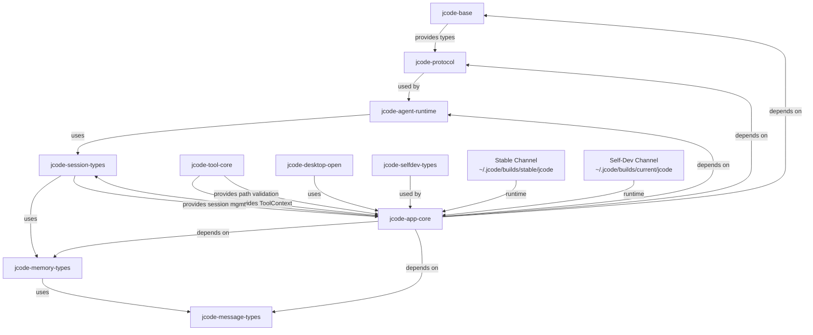

# System Map

## Mermaid Diagram of Components and Data Flow

## Module Table

| Path | Responsibility | Depends On | Depended On By |
|------|---------------|------------|----------------|
| `crates/jcode-tool-core/src/lib.rs` | ToolContext struct, path validation (`resolve_path`, `verify_path`), `require_validator` field | `jcode-app-core`, `jcode-base` | `jcode-app-core` |
| `crates/jcode-tool-core/src/path_jail.rs` | Path jail validation logic | `jcode-tool-core` | `jcode-app-core` |
| `crates/jcode-app-core/src/mod.rs` | Main module, tool dispatch, session management | `jcode-tool-core`, `jcode-base`, `jcode-protocol` | `jcode-desktop-open`, UI layers |
| `crates/jcode-app-core/src/tool/browser.rs` | Browser tool implementation | `jcode-tool-core`, `jcode-app-core` | UI, user sessions |
| `crates/jcode-app-core/src/tool/skill.rs` | Skill tool implementation | `jcode-tool-core` | Agent turns |
| `crates/jcode-app-core/src/tool/todo.rs` | Todo tool implementation | `jcode-tool-core` | Agent turns |
| `crates/jcode-app-core/src/tool/edit_stats.rs` | Edit stats tool | `jcode-app-core` | Session tracking |
| `crates/jcode-app-core/src/tool/user_response.rs` | User response handling | `jcode-app-core` | Agent turns |
| `crates/jcode-app-core/src/server/` | Server session management | `jcode-app-core`, `jcode-network` | External connections |
| `crates/jcode-agent-runtime/` | Agent turn execution, MPSC streaming | `jcode-app-core`, `jcode-tool-core` | UI, providers |

## Entry Points

- `jcode run` -- starts the interactive agent session
- `jcode self-dev --build` -- builds and updates the shared daemon
- `jcode --version` -- shows version info

## Background Jobs

- Daemon at `~/.jcode/builds/shared-server/jcode` -- long-lived session manager
- Token accounting worker -- handles token usage tracking
- Telemetry worker -- sends usage metrics